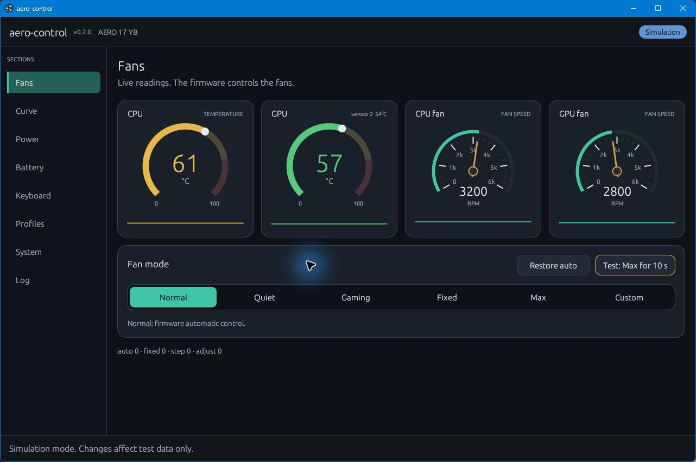

# aero-control

A native Rust desktop control panel for supported Gigabyte AERO laptops, built as an independent alternative to Gigabyte Control Center and selected AeroCtl features.

Control firmware fan modes and curves, request GPU performance levels, manage charging, adjust keyboard lighting, and use everyday Windows controls from one interface. **The firmware backend does not require Gigabyte's `acpimof.dll`, Control Center, or registration of Gigabyte MOF classes.** It opens the laptop's WMI firmware blocks directly through Windows APIs.

**Version: 0.2.5 — pre-release.** Current hardware support targets the **AERO 17 YB / P77YB, BIOS FB10, Intel Core i7-10875H and RTX 2080 Super Max-Q**. Fan control also works with the NVIDIA GPU disabled. Other model names are detected and displayed, but their fan and firmware power writes remain disabled until their command sets are verified.



*Fans tab in Simulation mode. Readings shown are sample data.*

## Features

| Area | Available controls |
|---|---|
| Fans | Normal, Quiet, Gaming, Fixed, Max and a firmware curve editor; temperature and RPM history; startup mode detection |
| Curves | Official reference Factory curve, editable points, exact raw duty values, registry/text import, complete 15-slot upload and readback |
| GPU | Control Center's Level 1 / Level 2 power requests and Standard / Quiet thermal profiles |
| CPU | Official i7 power presets through an optional compatible Intel XTU installation; availability checks, readback and rollback |
| Battery | Standard charging or a custom 60–100% stop limit; battery status |
| Keyboard | Built-in Gigabyte ITE lighting effects, colours, brightness, speed, direction, five saved profiles and solid custom pictures |
| Profiles | Automatic fan-mode memory and startup/resume restoration; named settings, optional full-profile rules, charger/battery switching, tray operation and Windows logon startup |
| System | Volume/mute, AC/DC brightness, Wi-Fi/Bluetooth radios, camera, sleep/hibernation USB charging, display refresh rates and device information |
| Laptop keys | Opt-in fan and Wi-Fi Fn handling, plus an explicit Fn+F6 display-off assignment |

See the detailed [Control Center coverage](docs/PARITY.md) and [AeroCtl comparison](docs/AEROCTL_PARITY.md). Implemented controls are not a claim that every feature has been physically validated.

## Rust and DLL dependencies

The desktop app, firmware transport, fan logic, keyboard HID implementation and Windows controls are written in Rust. There is no bundled Gigabyte helper DLL, custom kernel driver, or aero-control background service.

Optional **CPU power tuning is an exception**: a small embedded PowerShell bridge calls the signed Intel XTU SDK already installed on the machine. It needs a compatible Intel service and processor configuration. CPU tuning can be unavailable while the rest of the app works. Intel binaries are not bundled, installed or replaced by aero-control.

Normal Windows libraries, device drivers and the NVIDIA driver are still used. "No Gigabyte DLL required" does not mean the executable has no operating-system dependencies.

## Build and run

Use Windows 10/11 x64, a Rust toolchain (declared minimum Rust 1.85), and the Microsoft C++ build tools with a Windows SDK. Build from the repository root:

```powershell
cargo build --locked --release -p aero-gui
.\target\release\aero-gui.exe
```

The release GUI opens **without a console window**. Windows requests administrator access for firmware operations. The app shows its version in the header and in the executable's Windows file properties.

For a debug build, use `cargo build --locked -p aero-gui` and run `target\debug\aero-gui.exe`. Debug builds keep the console for diagnostics. Run the executable directly and approve elevation rather than relying on a non-elevated `cargo run` session.

To explore without controlling hardware:

```powershell
.\target\release\aero-gui.exe --mock
```

Simulation is clearly labelled and uses in-memory hardware and settings. A Windows production executable may still request administrator consent because its manifest is embedded at build time.

If using a packaged release, extract the whole ZIP to a permanent folder and launch `aero-gui.exe`. Keep that path stable: the app registers it for Windows background startup. Close older copies before opening an updated build.

On its first supported release launch, the app automatically sets up Windows background startup after the normal administrator prompt. Choose your fan mode; future Windows sign-ins restore it silently. Quitting the app does not disable startup. To opt out, use **Profiles → Start with Windows → Disable logon startup**; later launches respect that choice. Simulation, debug builds, unsupported hardware and invalid settings do not trigger automatic setup. Setup errors are shown rather than reported as success.

## How fan control works

The app sends a mode or curve to the embedded controller; **the firmware runs the fans**. Sensor polling displays readings and does not continuously calculate or write fan speeds. There is no software fan-control loop.

- **Normal** uses the official normal firmware sequence.
- **Quiet** selects the quiet thermal profile and official quiet fan settings.
- **Gaming** enables the firmware boost fan curve, selects the Standard thermal profile and sends a GPU Level 2 request.
- **Fixed** sets one duty for both fans. **Max** requests raw duty 229, the protocol's full-scale value.
- **Custom** uploads the validated firmware curve. Once Custom is active, valid editor changes apply automatically when editing finishes.

Factory and reference quiet curves identify the hardware where they were obtained; they are not automatically factory curves for every model the app can name. The plotted step response is an estimate of firmware behaviour. See [fan control details](docs/FAN_CONTROL.md).

Mode and curve operations check durable fan/thermal settings and curve bytes. Failures attempt the official Normal recovery sequence and report failed recovery explicitly. Normal application exit attempts Normal restoration after Fixed or Max. A forced termination cannot run cleanup, so a fixed setting may remain until another controller or the firmware changes it. CPU/GPU/EC thermal protection remains essential.

## GPU and CPU power

**GPU Level 1 and Level 2 are requests, not wattage sliders.** The NVIDIA request flag can clear within milliseconds after a command. It is not used as a permanent confirmation of the GPU's active power budget. The UI shows the last request sent in the current session; it starts unknown after restart. The thermal profile has a separate, durable Standard/Quiet getter. Actual GPU power and performance under load are not yet validated.

The supported i7 CPU presets match Control Center's reference table:

| Preset | Sustained limit | Short-burst limit |
|---|---:|---:|
| Level 1 | 38 W | 107 W |
| Level 2 | 45 W | 107 W |
| Level 3 / official default | 52 W | 107 W |
| Level 4 | 58 W | 107 W |
| Level 5 | 62 W | 107 W |
| Official battery preset | 45 W | 56.25 W |

CPU changes require an explicit Apply or an explicitly enabled profile action. The bridge checks compatibility and supported writable values, verifies both limits, and attempts rollback on a failed pair write. A timeout can leave a partial change. The development machine's installed Intel XTU currently fails compatibility/connection checks, so real CPU tuning remains unverified. The app does not change Windows security settings to bypass Intel restrictions.

## Profiles and everyday use

Successful fan changes are remembered automatically and restored when the app opens or resumes from sleep, matching Control Center's manual-mode lifecycle. This includes exact fixed duties and custom curves. Failed requests and the ten-second Max test do not replace the remembered preference. Fan restoration is enabled by default, including when upgrading existing settings; it can be disabled on **Profiles**. Windows startup is set up automatically on the first supported release launch and keeps aero-control in the notification area without creating the control window. Opening the app later brings up that same running controller. Startup can be disabled or re-enabled on **Profiles**.

Named profiles also store an available CPU preset, the last locally requested GPU level and the charging policy. Saving a profile does not apply it. Full-profile startup/resume rules, charger switching and laptop hotkeys remain opt-in. Enabled full-profile rules take priority over fan-only restoration. Background resume handling, profile switching and tray operation require the app to remain running.

System settings refresh on page entry, explicit refresh and relevant changes. Wi-Fi/Bluetooth controls enumerate Windows radios; they do not scan for nearby devices. There is no periodic refresh loop on the System page.

Settings are separate from Control Center:

- Profiles and automation: `%APPDATA%\aero-control\profiles.toml`
- Keyboard settings: `%APPDATA%\aero-control\keyboard-lighting.txt`
- WMI call logs: normally `%ProgramData%\AeroCtl\logs`; see **Log** for the active path.

The Gigabyte `CustomFanTable` registry import is read-only. Running multiple control apps can overwrite the same firmware settings. See the [user guide](docs/USER_GUIDE.md) for lifecycle behaviour, troubleshooting and profile details.

## Status and limitations

Gaming command completion, the GPU request path and Normal restoration have been checked on the reference laptop. Automated tests cover command sequences, simulated hardware failures, profiles, model gates, radio/display logic and CPU bridge failure handling. Those checks do not establish universal hardware support or thermal safety under every workload.

Current exclusions include vendor AI/cloud integration, Pantone calibration, full Fusion keyboard macros and a physical per-key editor, newer-model MUX/Dynamic Boost paths, and software fan control. There is no installed aero-control service, automatic driver installer or vendor-app coexistence manager. CPU tuning depends on Intel compatibility; full charging, display, radio, hotkey, resume and thermal/load validation is still incomplete.

## Development and documentation

```powershell
cargo fmt --all -- --check
cargo test --locked --workspace --exclude aero-gui
powershell.exe -NoProfile -ExecutionPolicy Bypass -File .\scripts\test-gui.ps1
powershell.exe -NoProfile -ExecutionPolicy Bypass -File .\crates\aero-gui\tests\cpu_power_bridge.tests.ps1
```

The GUI test helper compiles the actual GUI/session source into a test-only executable without the production administrator manifest. Tests use simulated hardware. Windows CI runs these checks and builds the release GUI; it does not validate laptop hardware. See [CONTRIBUTING.md](CONTRIBUTING.md).

- [User guide](docs/USER_GUIDE.md)
- [Architecture and implementation](docs/ARCHITECTURE.md)
- [Fan modes, curves and validation](docs/FAN_CONTROL.md)
- [Verified sources and hardware observations](docs/SOURCES.md)
- [Control Center feature coverage](docs/PARITY.md) / [AeroCtl comparison](docs/AEROCTL_PARITY.md)
- [Release preparation](docs/RELEASING.md) / [Changelog](CHANGELOG.md)

## License and provenance

The repository declares dual licensing under [MIT](LICENSE-MIT) or [Apache-2.0](LICENSE-APACHE), at your option. Dependency licenses are separate.

This is an independent project, not an official Gigabyte product. Its Rust implementations were developed from the local firmware/Control Center reference material, protocol observations and Windows APIs. AeroCtl is a functional comparison target; its GPLv3 source is not copied or vendored. This repository does not distribute Gigabyte/Intel application binaries or the separate decompiled reference project. Evidence and remaining uncertainties are recorded in [SOURCES.md](docs/SOURCES.md).
